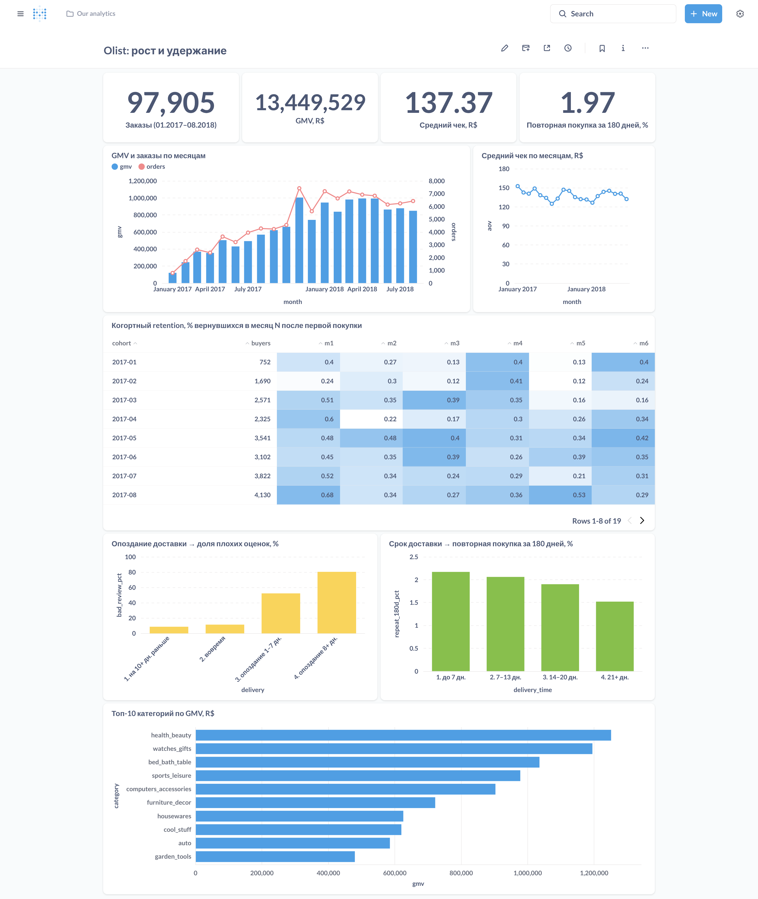

# Olist: почему покупатели маркетплейса не возвращаются

Продуктовый анализ бразильского маркетплейса Olist: ~100 тыс. заказов за 2016–2018 годы.
SQL (PostgreSQL), проверка гипотез, юнит-экономика, дашборд в Metabase.



## Вопрос

Olist растёт за счёт новых покупателей. Возвращаются ли они, что на это влияет и сколько маркетплейс может тратить на привлечение?

## Главные выводы

Период — полные месяцы 01.2017–08.2018. Деньги — в реалах (R$).

1. **Масштаб.** 97 905 заказов, 94 703 покупателя, GMV 13,45 млн R$, средний чек 137 R$. С 03.2018 рост заказов остановился на уровне 6–7 тыс. в месяц.
2. **Повторных покупок почти нет.** За 180 дней после первой покупки возвращаются **1,96%** покупателей. LTV за 180 дней (140 R$) всего на 1,4% выше первого месяца (138 R$).
3. **Ловушка в данных.** ~30% «вторых заказов» сделаны в течение часа после первого: это одна корзина, разбитая на несколько заказов. Повторной считается покупка через 24 ч и позже, иначе retention завышен.
4. **Опоздание доставки бьёт по оценке.** При опоздании на 8+ дней 80% оценок — 1–2 звезды, при доставке вовремя — 11%.
5. **На повторные покупки значимо влияет только очень долгая доставка.** Доставка 21+ день: 1,52% повторных против 2,17% при доставке до 7 дней (z-тест, p = 0,001). Само опоздание к обещанной дате значимого эффекта не дало (p = 0,10). Это корреляция, не причинность.
6. **Юнит-экономика (на допущениях).** При комиссии 10–20% маркетплейс может тратить на привлечение покупателя 8–22 R$, чтобы окупить его за год. Рост доли вернувшихся в 2,5 раза поднимает этот предел лишь на ~4%: экономику определяют комиссия и стоимость привлечения, а не retention.

### Рекомендации

- Не делать ставку на дорогие программы лояльности: при текущей базе они не окупятся.
- Сокращать длинный хвост доставки (21+ день): из проверенных факторов только он значимо связан с возвратом, и он же снижает оценки.
- Проверить причинность A/B-тестом: ускоренная доставка для случайной части покупателей в удалённых регионах, метрика — повторная покупка за 180 дней.

Подробнее: [выводы](docs/findings.md) · [юнит-экономика](docs/unit-economics.md) · [качество данных](docs/data-quality.md) · [ER-схема](docs/er-diagram.md)

## Структура

```
sql/
  01_schema.sql            схема БД: ключи, связи
  02_load.sql              загрузка CSV
  03_data_quality.sql      12 проверок качества данных
  10_core_metrics.sql      GMV, заказы, покупатели, средний чек
  11_cohort_retention.sql  когортный retention, повтор за 90/180 дней
  12_ltv.sql               LTV по GMV за 180 и 365 дней
  20_delivery_reviews.sql  доставка, отзывы и повторные покупки
  30_dashboard_views.sql   витрины для Metabase
scripts/
  get_data.sh              скачать данные и загрузить в PostgreSQL
  significance.py          z-тест для двух долей
  unit_economics.py        юнит-экономика и сценарии
  metabase_setup.py        создать дашборд через API Metabase
docs/                      выводы, ER-схема, качество данных, юнит-экономика
```

## Как воспроизвести

Нужны PostgreSQL 14+, Python 3, Docker.

```bash
./scripts/get_data.sh                                   # данные -> база olist
psql -d olist -f sql/20_delivery_reviews.sql            # view first_orders
psql -d olist -f sql/30_dashboard_views.sql             # витрины
python3 scripts/significance.py                         # проверка значимости
python3 scripts/unit_economics.py                       # юнит-экономика

# дашборд
psql -d olist -c "CREATE ROLE metabase LOGIN PASSWORD 'metabase'; GRANT USAGE ON SCHEMA olist TO metabase; GRANT SELECT ON ALL TABLES IN SCHEMA olist TO metabase;"
psql -d postgres -c "CREATE DATABASE metabase_app OWNER metabase;"
docker compose up -d                                    # Metabase на http://localhost:3000
python3 scripts/metabase_setup.py
```

## Данные

[Olist: Brazilian E-Commerce Public Dataset](https://github.com/olist/work-at-olist-data) (лицензия MIT; тот же набор опубликован на Kaggle). Данные анонимизированы. Комиссии маркетплейса и затрат на привлечение в них нет, поэтому юнит-экономика построена на явно указанных допущениях.

## Ограничения

- Наблюдаем только покупки: нет визитов, корзин, маркетинговых каналов.
- Влияние доставки — корреляция; удалённость региона может влиять и на доставку, и на повторные покупки.
- Комиссия, эквайринг и операционные затраты в юнит-экономике — допущения.
