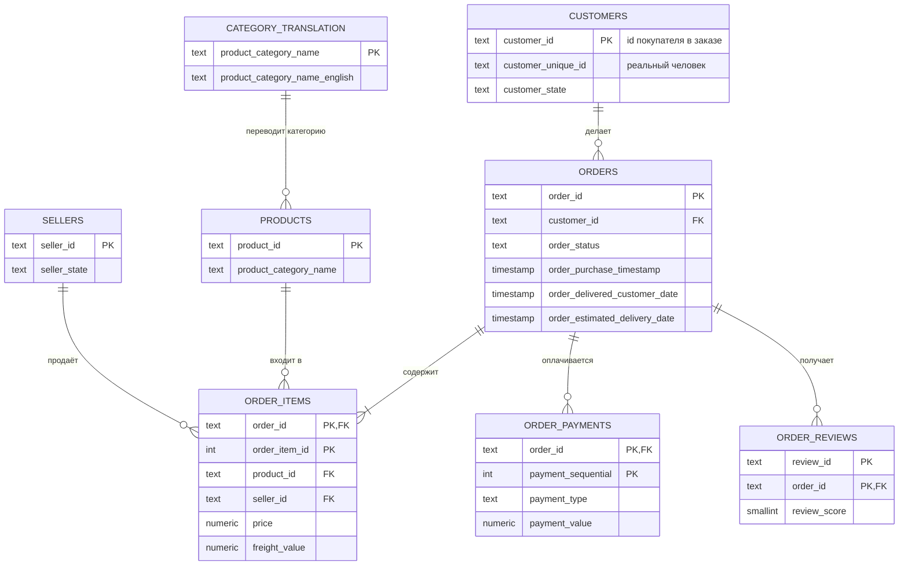

# ER-схема Olist

`geolocation` на схеме не показана: у неё нет ключа (несколько координат на один почтовый индекс), с остальными таблицами она связывается только по `zip_code_prefix` и в основных метриках не участвует.

## Как читать связи

- `||--o{` — «один ко многим, может быть ноль»: у покупателя-в-заказе может быть ноль или больше заказов.
- `||--|{` — «один ко многим, минимум один»: у заказа по смыслу есть хотя бы одна позиция (на деле 775 заказов без позиций — см. качество данных).
- **Главная ловушка:** `customer_id` новый в каждом заказе. Чтобы найти повторного покупателя, нужно идти в `customers.customer_unique_id`. Если считать по `customer_id`, повторных покупок будет ровно ноль.
